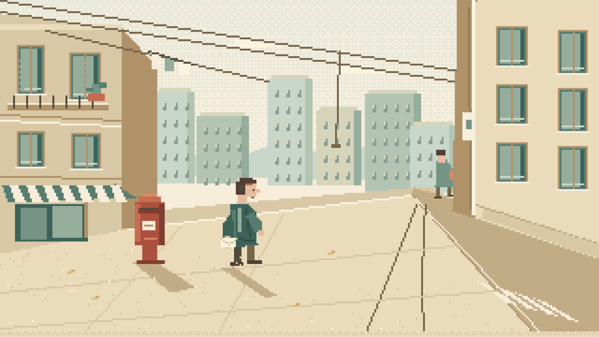
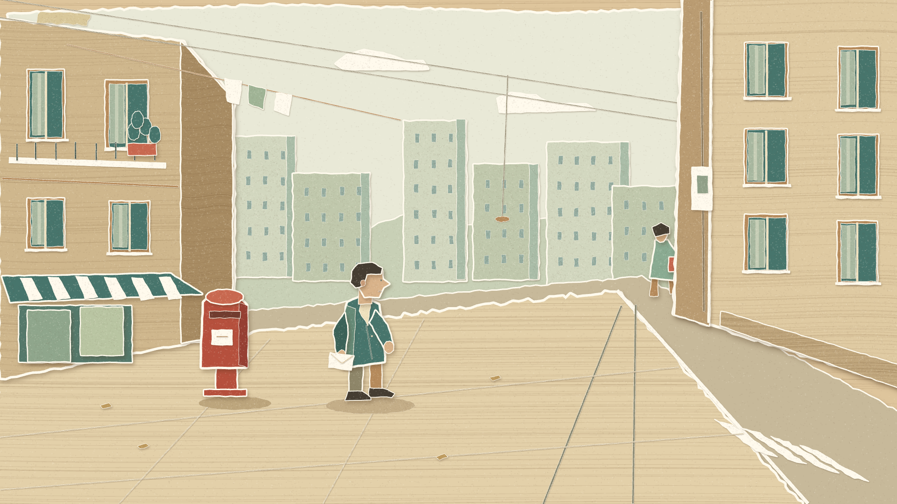
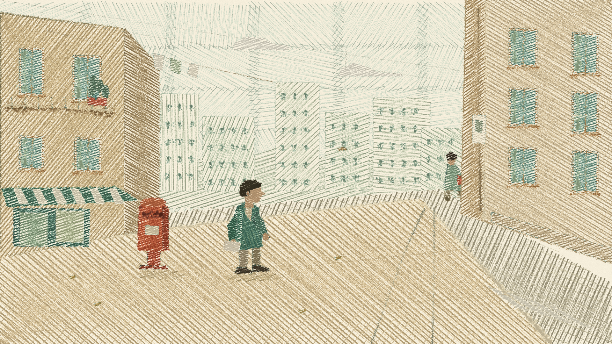

# 《十面埋伏》开场画风样图

状态：三种候选已打样，**用户已选择纸艺拼贴绘本collage，并确认v1.1螃蟹角色造型**。角色设定见项目根目录character-sheet.png与character-lyric-sheet.png；后续故事尚未锁定。

三张均为1920×1080 PNG，由程序原生绘制；未使用图像生成模型，也未用同一张栅格图套滤镜。共同开场：日间旧城街角，红色邮筒旁的人手持信封，另一人的身影正消失在转角；把“生活轨迹很近，仍然错过”压缩成同一瞬间。角色仅作画风演示，不是已确认设定。

## 1. 像素游戏风



**适配理由：离散的像素格与角色动作，能把“只差一点点”的时间差变成直观、带怀旧感的城市寻人故事。**

- `pixel.js`直接在320×180 Canvas 2D逐格绘制，使用整数矩形、Bresenham线与扫描线多边形。
- 32色候选调色板，本张实用28色；天空采用Bayer有序抖动。
- 关闭平滑后放大6倍；导出图已逐像素验证每个6×6块颜色完全一致。
- 角色时间状态采用整数帧索引，不使用姿势补间。本轮仅交付静态样图，未制作完整走路等动作库。

## 2. 纸艺拼贴绘本



**适配理由：信封、邮筒和楼房像保存下来的纸片记忆，适合表现反复拼凑偶遇、始终无法重逢的遗憾。**

- `collage.js`将墙面、窗户、纸偶肢体、信封等作为独立纸片绘制，各自拥有纸质、剪切或毛边以及投影。
- 底纹采用程序生成的牛皮纸纤维，不使用可读报纸文字，不往画面添加标题或歌词。
- 时间量化为10次/秒，每个纸片使用“元素名＋帧号”种子作最多±2个输出像素的位移。静态样图不验证完整定格动画的观感。

## 3. 蜡笔手绘绘本



**适配理由：露出纸底的蜡笔排线和不齐整的轮廓，能让城市寻找带着回忆的温度，同时保留孤独与失落。**

- `crayon.js`实际调用本地p5.js 2.3.3和p5.brush 2.2.3，使用蜡笔笔刷排线、交叉叠色及2B笔刷轮廓。
- 自定义wax笔刷通过p5.brush绘制，不是Canvas噪声滤镜伪装笔刷。
- 纸纹由代码生成；填色种子固定，轮廓种子按12次/秒量化，避免未来制作时填色闪烁。
- 此分支使用WebGL，复制输出前等待p5初始化并完成绘画，最后同步GPU再导出。初次捕获的空画面已经排查并替换，最终交付图已打开检查。

## 色彩与范围

采用奶油色、浅牛皮纸色、鼠尾草绿和褪色砖红；红色邮筒为主要强调色。不使用深色背景配霓虹、紫色渐变或堆叠文字。第三张排线保留得较明显，便于与另外两种原生画法比较，用户选择后仍可调整密度。

本轮只制作样图。角色设计、完整动作、歌词排版、分镜和整片制作均未推进。

## 本地查看与复现

直接打开三个PNG即可比较。`index.html?style=pixel`、`?style=collage`、`?style=crayon`提供各自绘画入口；所有库均从vendor本地加载，无需运行时联网。

```powershell
.\.conda\mv\python.exe styles/render_studies.py pixel collage crayon --budget 30000
```

脚本默认使用本机Chrome，输出覆盖本目录同名PNG。当前受限执行环境采用进程内软件WebGL和独立项目缓存配置；不会读取用户浏览器登录配置。QA摘要见 `qa.json`。

外部库源地址：

- https://cdn.jsdelivr.net/npm/p5@2.3.3/lib/p5.min.js
- https://cdn.jsdelivr.net/npm/p5.brush@2.2.3/dist/p5.brush.js

外部库是绘图运行时，不是外部画面素材；其许可与再分发要求在后续正式打包时另行核对。
